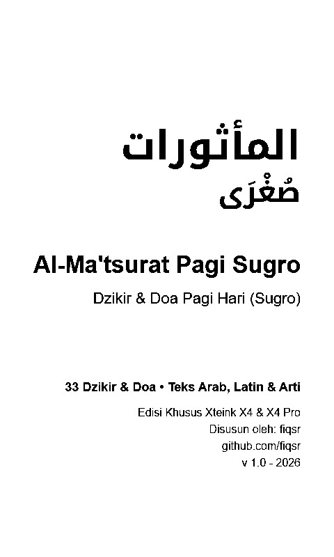
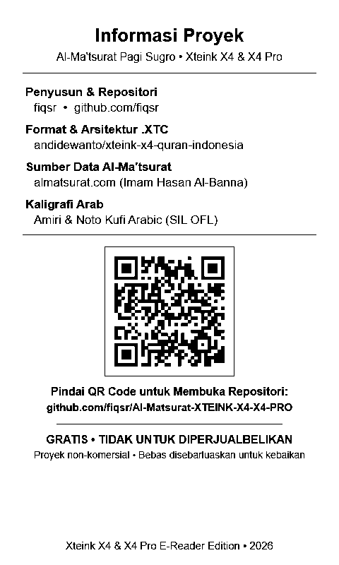
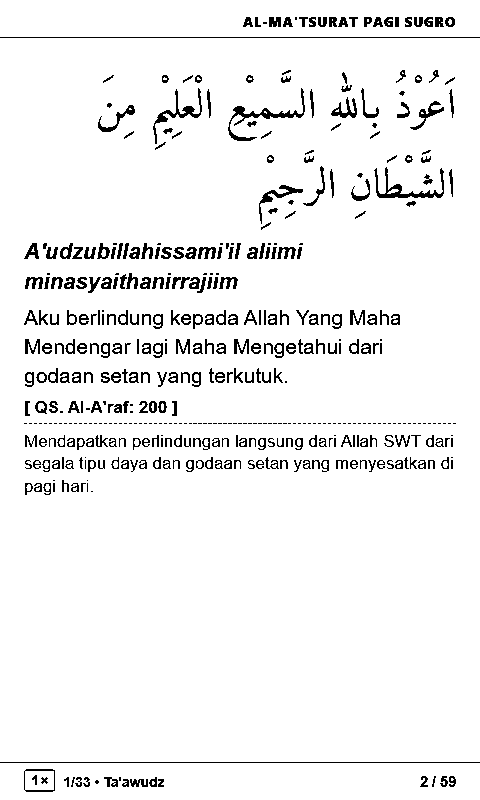
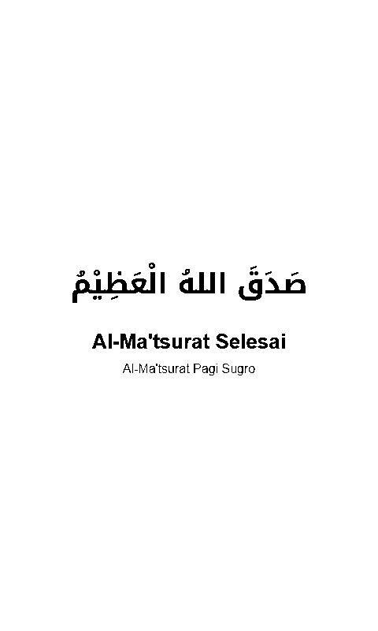

# Al-Ma'tsurat untuk Xteink X4 & X4 Pro (Sugro & Kubro)

[](https://github.com/fiqsr/Al-Matsurat-XTEINK-X4-X4-PRO/releases/latest)
[-2ea44f?logo=github)](https://github.com/fiqsr/Al-Matsurat-XTEINK-X4-X4-PRO/releases/download/v1.0.0/01-Al-Matsurat-Pagi-Sugro.xtc)
[-blue?logo=github)](https://github.com/fiqsr/Al-Matsurat-XTEINK-X4-X4-PRO/releases/download/v1.0.0/02-Al-Matsurat-Petang-Sugro.xtc)
[-purple?logo=github)](https://github.com/fiqsr/Al-Matsurat-XTEINK-X4-X4-PRO/releases/download/v1.0.0/03-Al-Matsurat-Pagi-Kubro.xtc)
[-orange?logo=github)](https://github.com/fiqsr/Al-Matsurat-XTEINK-X4-X4-PRO/releases/download/v1.0.0/04-Al-Matsurat-Petang-Kubro.xtc)

Koleksi lengkap **Al-Ma'tsurat (Dzikir Pagi & Petang — Sugro & Kubro)** dalam format native **`.xtc`** yang disiapkan khusus untuk dibaca pada perangkat e-reader / e-paper saku **Xteink X4 & Xteink X4 Pro** (resolusi fisik 480 × 800 piksel).

Disusun dan dikembangkan oleh **fiqsr** ([github.com/fiqsr/Al-Matsurat-XTEINK-X4-X4-PRO](https://github.com/fiqsr/Al-Matsurat-XTEINK-X4-X4-PRO)).

---

## Pratinjau Tampilan (Resolusi Asli 480 × 800 px)

| Sampul Minimalis | Informasi & QR Code | Halaman Isi (Tajam & Maksimal) | Halaman Penutup |
| :---: | :---: | :---: | :---: |
|  |  |  |  |

---

## 4 Versi Buku `.XTC` Siap Pakai

1. **`xtc/01-Al-Matsurat-Pagi-Sugro.xtc`** (33 Dzikir & Doa) — Bacaan dzikir pagi praktis untuk rutinitas harian.
2. **`xtc/02-Al-Matsurat-Petang-Sugro.xtc`** (33 Dzikir & Doa) — Bacaan dzikir sore/petang praktis.
3. **`xtc/03-Al-Matsurat-Pagi-Kubro.xtc`** (44 Dzikir & Doa) — Bacaan dzikir pagi versi lengkap dengan wirid Al-Qur'an pilihan (QS. Al-Fatihah, Al-Baqarah, Ali Imran, At-Taubah, Thaha, Al-Mu'minun, Ar-Rum, Ghafir, Al-Hasyr, Az-Zalzalah, Al-Kafirun, An-Nashr, Al-Ikhlas, Al-Falaq, An-Naas).
4. **`xtc/04-Al-Matsurat-Petang-Kubro.xtc`** (44 Dzikir & Doa) — Bacaan dzikir petang versi lengkap.

---

## Fitur Utama

1. **Tipografi Besar & Tajam Khusus Layar E-Ink 4.3" (480 × 800 px)**:
   - **Teks Arab (`42px` Amiri Regular)**: Kaligrafi naskh yang besar, tegas, dan berharakat lengkap.
   - **Teks Latin (`22px` Bold Italic)**: Transliterasi tebal yang mudah dibaca di layar resolusi kecil tanpa gradasi abu-abu pudar.
   - **Terjemahan (`21px` Medium)** & **Sumber/Faedah (`17px`)**: Hitam pekat (`#000000`) untuk kontras 1-bit maksimal.
2. **Smart Greedy Flow Pagination**:
   - Memaksimalkan ruang baca di antara garis Header dan Footer (`1.5px solid #000`) tanpa ada harakat atas maupun teks bawah yang terpotong.
   - Menggabungkan teks Arab, Latin, Terjemahan, dan Faedah pada halaman yang sama bila ruang mencukupi sehingga tidak ada halaman yang mubazir/kosong.
3. **Footer Terpadu yang Informatif**:
   - Memuat kotak jumlah bacaan (`1×`, `3×`, `7×`, `10×`, `100×`), nomor urut & judul dzikir (`1/33 • Ta'awudz`), serta nomor halaman di satu baris footer yang rapi.
4. **Halaman Informasi Proyek & QR Code**:
   - Halaman ke-2 memuat informasi proyek, atribusi sumber, serta **QR Code** untuk mengunduh/membagikan repositori ini dengan mudah.
5. **Web Generator Mandiri (`generator/index.html`)**:
   - Dilengkapi aplikasi web generator offline dengan pilihan 4 versi Al-Ma'tsurat, pencarian dzikir, pratinjau layar langsung, dan tombol **EXPORT .XTC**.

---

## Struktur Proyek

```text
Al-Matsurat-XTEINK-X4-X4-PRO/
├── docs/
│   └── preview/
│       ├── 00-sampul.png
│       ├── 01-informasi.png
│       ├── 02-halaman-01.png
│       ├── 03-halaman-falaq.png
│       ├── 04-penutup.png
│       └── repo_qrcode.png
├── data/
│   ├── pagi_sugro_clean.json
│   ├── sore_sugro_clean.json
│   ├── pagi_kubro_clean.json
│   └── sore_kubro_clean.json
├── generator/
│   └── index.html                     # Web Generator interaktif mandiri (self-contained)
├── xtc/
│   ├── README.md
│   ├── 01-Al-Matsurat-Pagi-Sugro.xtc
│   ├── 02-Al-Matsurat-Petang-Sugro.xtc
│   ├── 03-Al-Matsurat-Pagi-Kubro.xtc
│   └── 04-Al-Matsurat-Petang-Kubro.xtc
├── push.bat                           # Skrip sekali-klik push ke GitHub
├── ATTRIBUTION.md
├── LICENSE.md
└── README.md
```

---

## Cara Menggunakan pada Xteink X4 & X4 Pro

1. Unduh berkas `.xtc` dari folder **`xtc/`**.
2. Sambungkan perangkat Xteink X4 / X4 Pro ke komputer via kabel USB atau masukkan kartu microSD.
3. Salin keempat file `.xtc` ke dalam penyimpanan perangkat.
4. Buka berkas melalui menu pembaca bawaan perangkat.

---

## Atribusi & Sumber Data

- **Penyusun & Desain:** [fiqsr](https://github.com/fiqsr)
- **Repositori Proyek:** [Al-Matsurat-XTEINK-X4-X4-PRO](https://github.com/fiqsr/Al-Matsurat-XTEINK-X4-X4-PRO)
- **Sumber Materi Al-Ma'tsurat:** [almatsurat.com](https://almatsurat.com) (Susunan Asy-Syahid Imam Hasan Al-Banna)
- **Format & Arsitektur .XTC:** [andidewanto/xteink-x4-quran-indonesia](https://github.com/andidewanto/xteink-x4-quran-indonesia) oleh Andi Dewanto
- **Font Arab:** [Amiri Typeface](https://github.com/aliftype/amiri) & Noto Kufi Arabic (SIL Open Font License)
- **Lisensi:** MIT License • **GRATIS & TIDAK UNTUK DIPERJUALBELIKAN**
